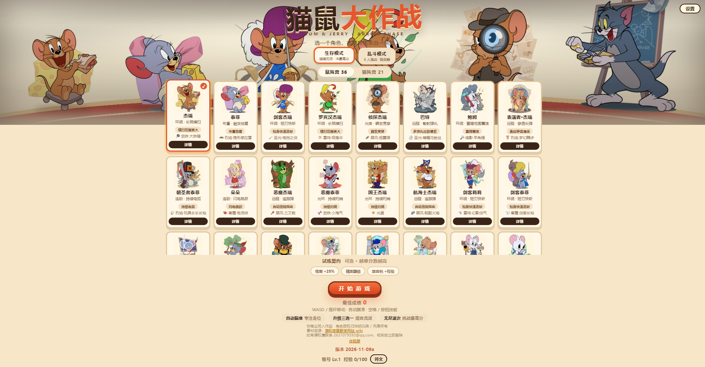
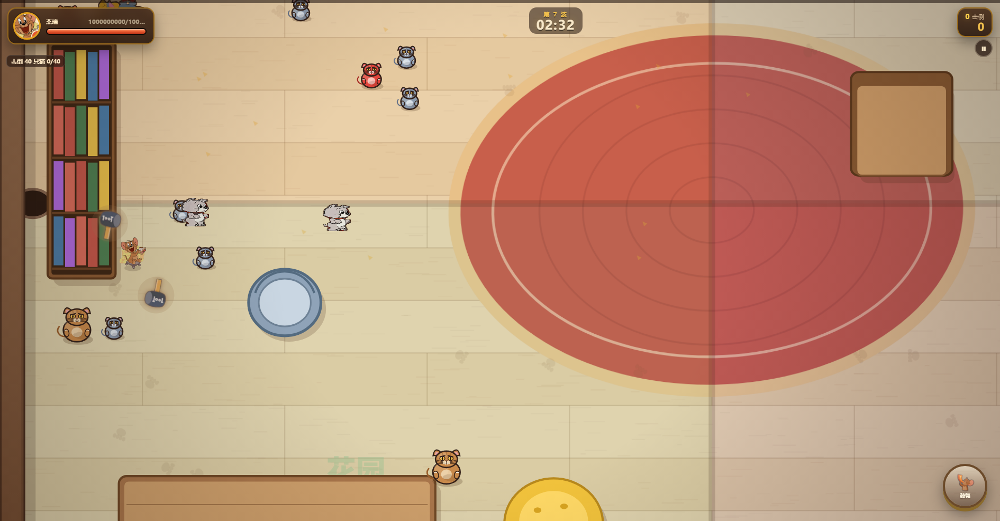
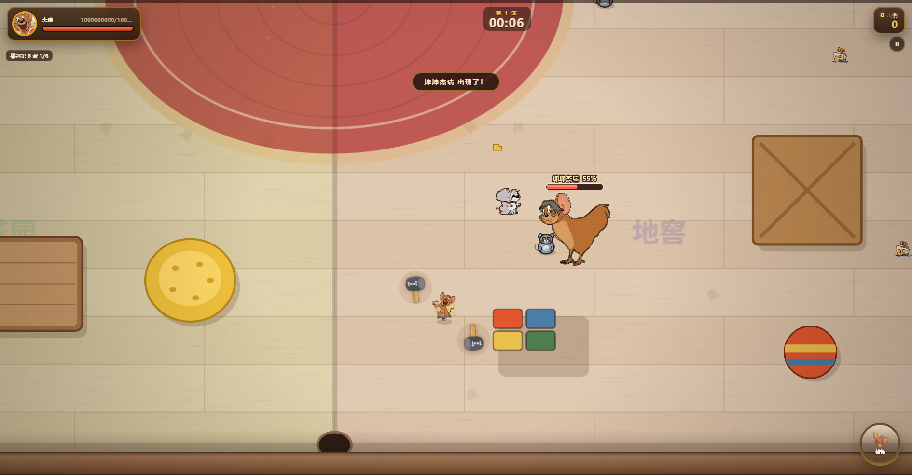
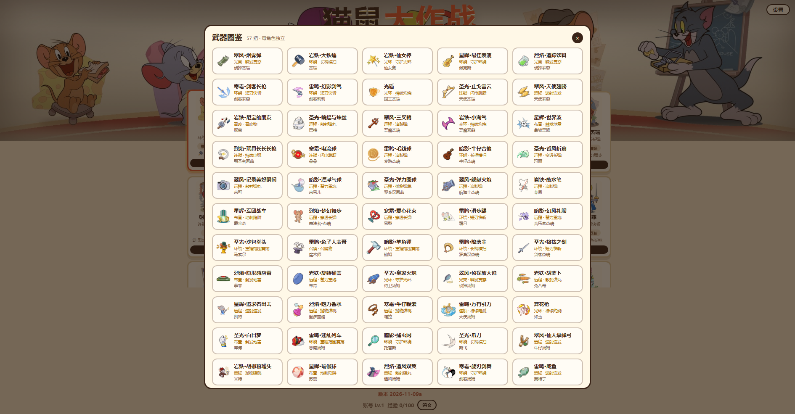
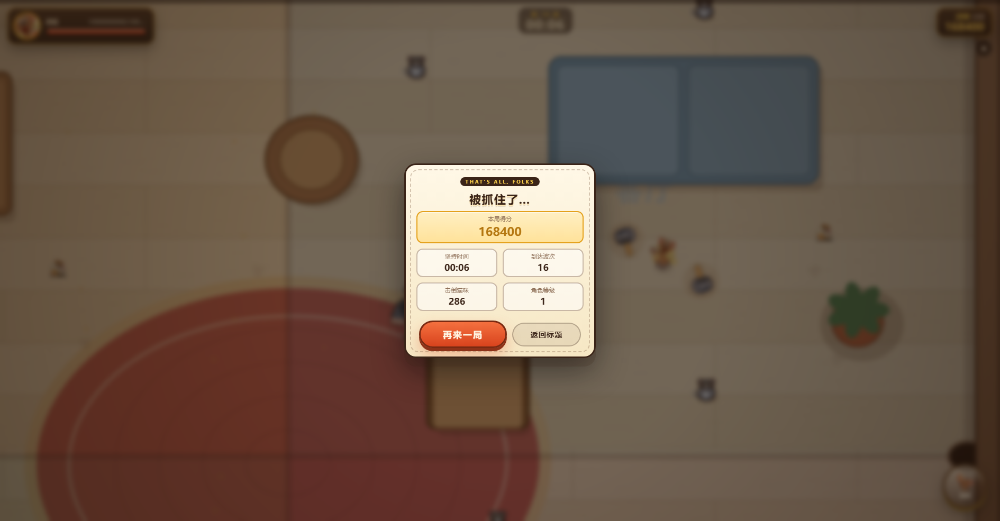

# 猫鼠大作战 · Tom & Jerry: Arrow Chase

一款非商业同人游戏：用《猫和老鼠》的角色与道具，做俯视角自动瞄准的生存 + 乱斗玩法。

纯前端 Canvas 2D，零依赖、免安装；同一套代码发布为网页版和安卓 APK。

- 体验服（网页）：https://lihuainch.github.io/tom-jerry-arena/
- 安卓安装包：Actions 的 `Build Android APK` 产物 `tomjerry-debug-apk`
- 问题反馈 / 侵权联系：2637079593@qq.com

## 内容规模

| 项目 | 数量 |
|---|---|
| 角色 | 57（36 鼠 / 21 猫） |
| 武器 | 57 把，每角色独立 |
| 武器类别 / 子类 | 7 大类 / 18 子类 |
| 进化分支 | 36 条（每子类 A/B） |
| Boss | 6 只 |
| 精英 | 9 种，带专属技能 |
| 特殊任务 | 2 个 |

## 玩法

### 生存模式

- 25 秒一波，敌人从四周推进
- 自动瞄准、自动开火，专注走位与三选一
- 5 种元素（火/冰/雷/光/暗）双槽融合，15 种融合效果
- 每类武器 4 级一次进化，A/B 二选一
- 特殊随机任务：被 78 个萝卜命中 / 被 91 个冰块命中，站桩 10 秒失败

### 乱斗模式

- 6 人混战，4 条命，180 秒或 12 杀
- AI 使用与玩家相同的角色、武器、升级池
- 地图夹子、冰块、灰瓶等道具

## Boss 排期

| 波次 | Boss |
|---|---|
| 3 | 坤坤杰瑞 |
| 6 | 绷带杰瑞 |
| 9 | 巨人僵尸 |
| 12 | 浅唱 |
| 15 | 不甘心的浅唱 |
| 18 | 陈佳嵘 |
| 21+ | 浅唱 + 不甘心的浅唱 + 陈佳嵘 |

Boss 均带专属技能与地面预警；精英从 3 波起每波 3 只，带红线/红圈/扇形前摇。

## 截图







## 技术

- 纯 Canvas 2D，无构建、无运行时依赖
- 固定 1/60 步长 + 种子随机，便于复现与自动测试
- 画质 高/中/低，手机帧率 30/45/60
- Capacitor 套壳安卓，桌面与移动端两套 HUD
- 测试工具：冒烟、压测、生存/乱斗数值模拟、无头浏览器截图

## 本地运行

```bash
# 任选一种静态服务器
python -m http.server 8126
# 打开 http://127.0.0.1:8126/
```

打包网页资源：

```bash
node tools/pack-web.mjs
```

安卓打包见 [BUILD_APK.md](BUILD_APK.md)。

## 素材来源

- 角色与部分素材来源：[猫和老鼠教学网站 wiki](https://tjwiki.com/)
- 其余 UI、特效与武器图标为自制
- 本项目为非商业同人作品，角色版权归华纳兄弟 / 网易等权利方所有

## 侵权删除声明

如权利方认为内容侵权，请联系 **2637079593@qq.com**，核实后将立即删除相关内容并停止分发。
